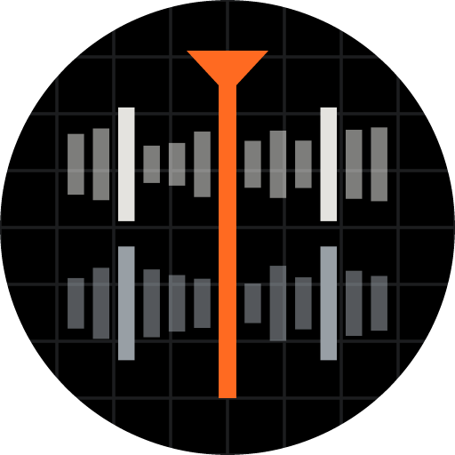

<p align="center">
  
</p>
<h2 align="center"><b>SideDeck</b></h2>
<h4 align="center">A SideDeck fork, built for the EP-136 K.O. Sidekick</h4>

I forked [SideDeck](https://github.com/manueljpy/SideDeck), the free DJ app
for Android and iPhone by Manuel Jiménez, and improved it. The work is mainly
aimed at giving the best experience with the Teenage Engineering EP-136 K.O.
Sidekick.

The phone plays two decks and sends them to the Sidekick over one USB-C
cable. The Sidekick does the mixing, EQ, effects and cueing. The app sticks
to what a phone screen is good at: finding the next track, showing where the
beat is, and starting it on time. Its look follows the Sidekick's own screen:
greyscale on black, with orange for what matters.

It still works without a Sidekick: on its own with the internal mixer, or
with any USB mixer that takes two stereo decks.

## What this fork adds

**Playing with the Sidekick**

- **USB buffer** (Android): Safe (~50 ms), Low (~20 ms) or Ultra (~10 ms).
  Settings shows the underrun count and an output latency estimate, so you can
  find the lowest setting your phone plays cleanly. If Low or Ultra does not
  start, SideDeck falls back to Safe and says so.
- **On air**: a deck shows ON AIR while the Sidekick has it in the mix. Only
  on-air time counts towards marking a track as played.
- **Sidekick check** (Settings): shows the MIDI messages, the levels of all 8
  USB inputs, the measured phone-to-mixer latency and each deck's share of the
  master.
- **Library and Settings on a rail** at the right edge in external mixer mode,
  out of the way of the decks.

**Beatmatching**

- **Quantize** (Settings, on by default, in every mode): a deck you start
  while the other plays lands on its beat, with keylock on and inside loops.
- **Steady zoom**: holding a nudge button no longer zooms the waveform in and
  out, so two grids at the same BPM stay the same size while you line them up.
- **Bars that look alike**: the waveform is drawn in equal slices of the beat
  grid from 2.5 ms of audio each. Every bar of a repetitive track looks the
  same, and with a correct grid every kick sits at the same spot after its
  line.
- **Kicks stand out**: the waveform is lit by the low EQ band.
- **BPM on a small LCD** in the deck header shows the tempo you hear. The
  track's own BPM stays next to its key.

**Library**

- **Music folder**: picking a folder replaces the library, and its subfolders
  show as playlists. BPM and key analysis is kept.
- **Played tracks** are marked in the library: 30 s on air counts as played,
  and "New set" clears the marks.
- **Overview strip** stacks the low, mid and high bands, so you can see where
  the drop is.

**Look**

- The Sidekick screen: black with a fine cell grid, grey beat lines, orange
  bar lines, and the Space Grotesk font.
- **Waveform style**: Solid, Dot matrix or Curve.
- **Outdoor mode**: a light screen for playing in daylight.
- A new app icon.

## Install

Test builds of this fork are on the
[Releases page](https://github.com/WHSchellekens/SideDeck/releases/tag/sidekick-test):
a debug APK for 64-bit Android phones, built by GitHub Actions from the
`sidekick-tuning` branch.

```bash
adb install -r sidedeck-test.apk
```

The fork keeps upstream's app ID, so a SideDeck from F-Droid, Google Play or
the App Store has to be uninstalled first. That also removes its library and
analysis.

## Using it with the Sidekick

1. Set the Sidekick's USB mode to **Multi** (not Controller).
2. Connect the phone with a USB-C cable.
3. In Settings, turn on **Use external mixer**. Deck A plays on USB channels
   1–2 and Deck B on USB channels 3–4. The on-screen EQ and crossfader hide;
   mix, EQ, add effects and cue on the Sidekick.
4. Set **USB buffer**. Start at Low. Try Ultra if it plays without crackles,
   and go back to Safe if Low crackles.
5. Optional, for **On air**: SideDeck reads the Sidekick's faders over USB
   MIDI if it sends them (CC 7 on channels 1–2). Otherwise, turn on **Listen
   to the mixer** (Android, needs the microphone permission). SideDeck then
   compares the Sidekick's master on USB inputs 7–8 with what each deck sends,
   which also measures the phone-to-mixer latency while you play.

On iPhone, use USB-C or a Lightning camera adapter. The mixer must be a
class-compliant USB audio device.

## Also in SideDeck

Everything from upstream SideDeck is still here:

- Dual-deck landscape UI with waveforms, no platters
- Native engine (Oboe on Android, Core Audio on iOS): MP3 / WAV / FLAC / Opus /
  Ogg Vorbis / AAC (M4A), and ALAC when the device has a decoder
- Internal mixer: 3-band EQ, filter, crossfader
- BPM and key analysis on load, cached in SQLite; Camelot labels
- Beat detection with Queen Mary TempoTrackV2 + Mixxx BeatUtils; key with
  Queen Mary GetKeyMode
- Sync, loops (½ / ×2 on the waveform), BPM ±0.1, temporary pitch bend
- Keylock (pitch-held tempo), on by default
- Tap the waveform to jump ±4 beats; GRID edits the beat grid (1 beat or 5 ms)
- File picker, sorting, analyze missing or all (iPhone: Files app / Finder
  sharing)
- Library highlights keys that fit a loaded deck
- Subsonic browsing and cache-to-file

Cue points and hot cues exist in the engine, but the live UI has no controls
for them yet.

### Subsonic

[Subsonic](http://www.subsonic.org/pages/api.jsp) is an API for a music
library you host yourself, and servers such as
[Navidrome](https://www.navidrome.org/) speak it. In Settings you can point
SideDeck at your server, browse albums and tracks, and download them to the
phone to mix like local files.

## Build

Requirements:

- Flutter stable (SDK ^3.12); see [install Flutter](https://docs.flutter.dev/get-started/install)
- Android: the NDK (ships with Flutter / Android Studio); Android 8.0+ (API 26), arm64 recommended
- iPhone: macOS with Xcode 15+ and CMake 3.22+ (`brew install cmake`); iOS 15+
- USB host / USB-C (or a Lightning camera adapter) if you use an external mixer

```bash
flutter pub get
flutter run -d <android-or-ios-device>
```

Debug APK:

```bash
flutter build apk --debug
```

Output: `build/app/outputs/flutter-apk/app-debug.apk`

iOS (macOS + Xcode + CMake):

```bash
flutter build ios --debug --no-codesign
```

Or open `ios/Runner.xcworkspace` in Xcode, pick your iPhone, and press Run.
CMake compiles the C++ engine during the Xcode build.

SideDeck is a Flutter application: a Dart UI with FFI into a C++ engine. See
the [Flutter docs](https://docs.flutter.dev/).

### Project layout

```
lib/                 Dart UI, controllers, Subsonic client, FFI
native/engine/       C++ engine, EQ, analysis, iOS Core Audio
android/app/         Android host, USB AudioTrack output, USB MIDI and input
ios/                 iPhone host, CMake engine build
third_party/         Oboe, Signalsmith, qm-dsp, dr_libs, ogg/opus/opusfile/vorbis
assets/fonts/        Space Grotesk (SIL OFL 1.1), the UI font
tool/                App icon generator
test/                Dart tests
native/engine/test/  Host unit tests for engine helpers (ctest)
```

Engine helper tests run on the host:

```bash
cmake -S native/engine -B build/native-tests && cmake --build build/native-tests
ctest --test-dir build/native-tests --output-on-failure
```

## Credits and license

SideDeck was created by Manuel Jiménez:
[github.com/manueljpy/SideDeck](https://github.com/manueljpy/SideDeck). The
original app is on
[F-Droid](https://f-droid.org/packages/es.manifold.sidedeck),
[Google Play](https://play.google.com/store/apps/details?id=es.manifold.sidedeck)
and the [App Store](https://apps.apple.com/app/id6827595789).

This fork is not affiliated with or endorsed by Teenage Engineering. EP-136
and K.O. are their product names.

SideDeck is free software under the [GNU GPL v3 or later](LICENSE), and so is
this fork. Third-party licenses are listed in [NOTICE](NOTICE) and
[third_party/README.md](third_party/README.md).
